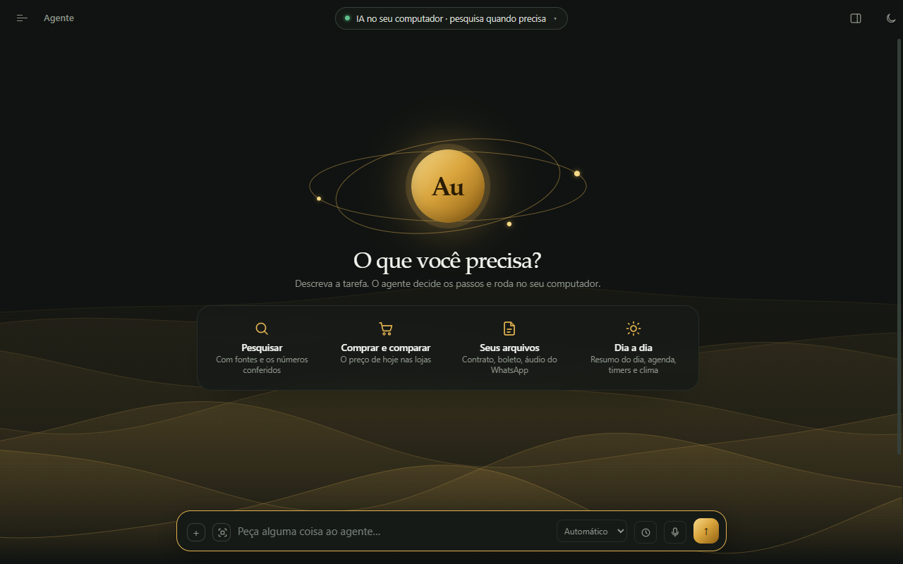
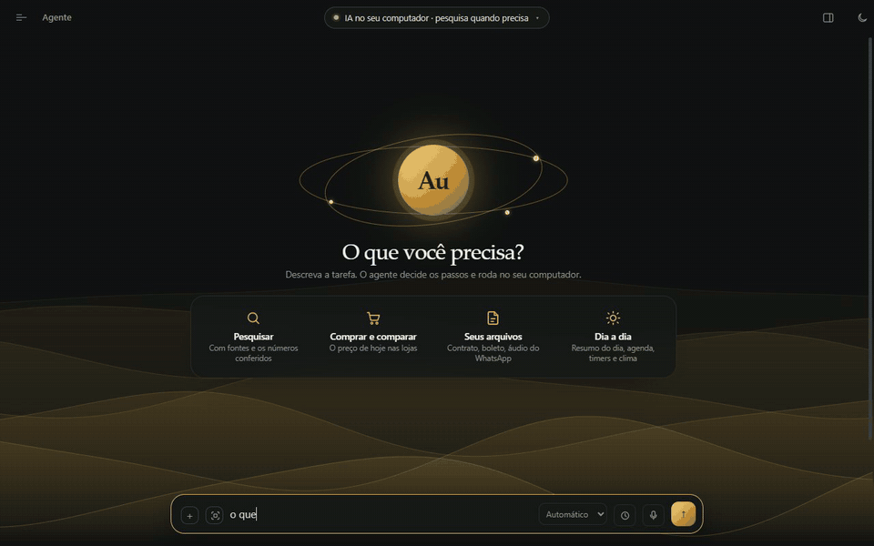
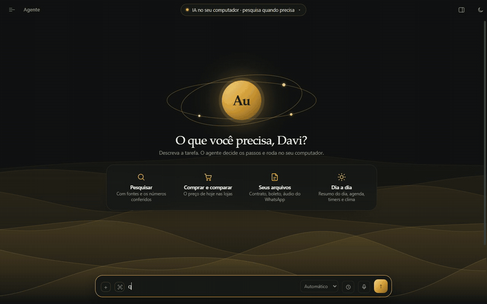
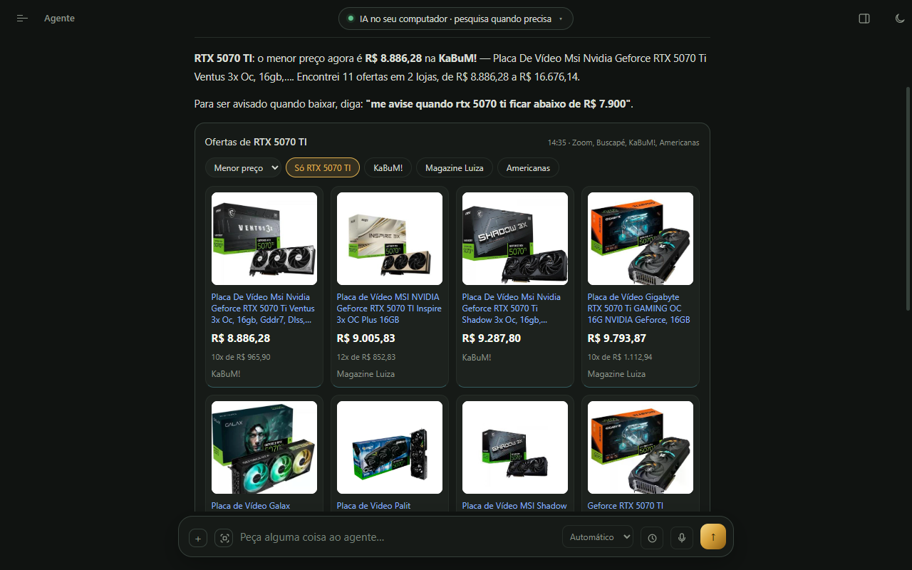
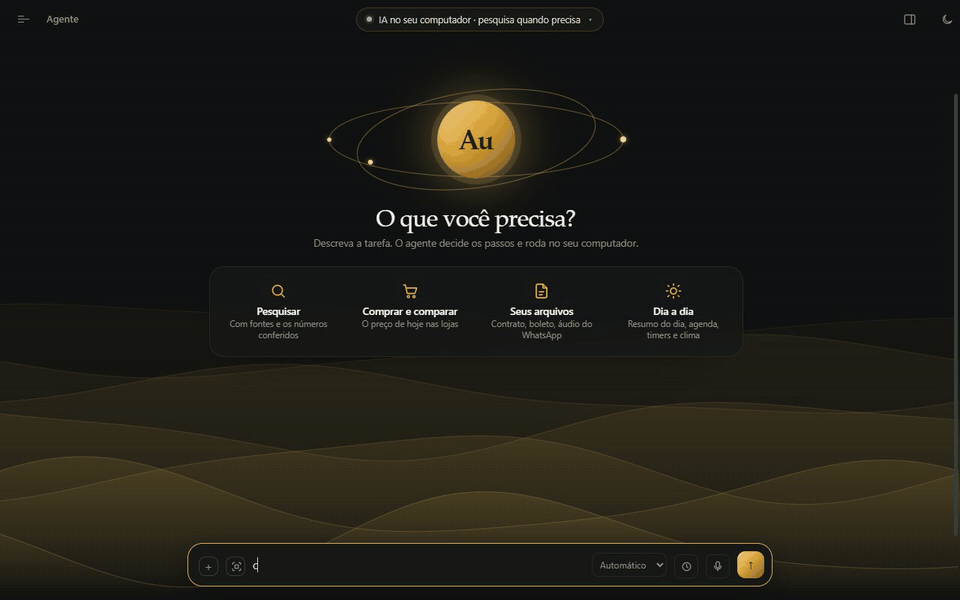

<div align="center">


# AuGPT

**A private AI assistant that runs on your own computer.**<br>
It researches the web and cites its sources, checks store prices, reads your files, helps with everyday tasks and shows every step it takes.<br>
The model runs on your machine through [Ollama](https://ollama.com): no conversation is ever sent to a cloud AI service.

[](https://github.com/D4v1K1ngg/augpt/releases)
[](#-requirements)
[](https://ollama.com)
[](LICENSE)

[**⬇️ Download**](https://github.com/D4v1K1ngg/augpt/releases) · [Features](#-what-it-does) · [Install](#-installation) · [Security](#-security-and-network) · [🇧🇷 Português](README.md)

<picture>
  <source media="(prefers-color-scheme: light)" srcset="docs/midia/inicio-claro.png">
  
</picture>

<sub>The screenshots show the Portuguese interface; the app also runs fully in English — it follows your Windows language, or pick it in Settings.</sub>

</div>

## ✨ Why AuGPT

| | |
|---|---|
| 🔒 **Private** | The AI runs on your PC. Conversations, memory and files stay with you. |
| 🔎 **Cites its sources** | Every researched answer lists the pages it read, with each one's date. |
| ✅ **Checks what it writes** | Numbers and years in the answer are compared with the pages it read; anything not found in the sources gets a ⚠. |
| 🛒 **Today's prices** | Prices come from the store's page, not from the model's memory — and it warns you when a source is outdated. |
| 👀 **Transparent** | The *Agent activity* card shows every search and every page read; the research is narrated as it happens. |
| 🧠 **Small models, real work** | Built and tested for 4B–9B local models (Qwen 3.5): code handles what code does best (prices, currency, timers, PC info), the model writes. |

## 🎬 See it in action

<table>
<tr>
<td width="50%" valign="top">

**Research with sources**<br>
<sub>It searches, reads the pages, narrates what it finds and answers citing each source. (4× speed; the real answer took 45 s on an 8 GB GPU.)</sub>



</td>
<td width="50%" valign="top">

**Exchange rates instantly**<br>
<sub>Currencies come straight from data APIs (AwesomeAPI and the Central Bank of Brazil), no web search needed.</sub>



</td>
</tr>
<tr>
<td width="50%" valign="top">

**Store prices**<br>
<sub>Offer cards from cheapest to most expensive, with photo, installments and link.</sub>



</td>
<td width="50%" valign="top">

**Timers and alarms**<br>
<sub>By chat or by voice; a beep and a Windows notification when it ends.</sub>



</td>
</tr>
</table>

## 🧰 What it does

Everything below also appears in the **Utilities** tab, with a button for each feature — or just ask it: *"what can you do?"*

### 🔎 Research

| | Feature |
|---|---|
| 📰 | **Answers with sources** — several searches, reads the pages, checks numbers and years, flags with ⚠ what the sources don't say |
| 🛒 | **Products and where to buy** — recommendations as cards, with what the community says (Reddit, forums) and today's store price |
| 🏷️ | **Store prices** — cheapest first, with photo and link, and a warning for suspicious prices |
| 📈 | **Price analysis and forecast** — the price timeline since launch and an estimate for Black Friday |
| 💵 | **Exchange rates** — dollar, euro, pound, bitcoin and conversions, with the official Central Bank rate |
| 🧪 | **Deep investigation** — researches for as long as you choose and delivers a full PDF report |
| ▶️ | **YouTube videos** — watches through the subtitles and reads the top comments |
| 🖼️ | **Image search** — a gallery showing which site each picture came from |

### ☀️ Everyday

| | Feature |
|---|---|
| 🌅 | **Morning briefing** — date, next holiday, your city's weather and your agenda (*"good morning"*) |
| ⏱️ | **Timers and alarms** — countdown card, beep and Windows notification |
| 📅 | **Agenda and reminders** — notifies you on time and follows topics for you (launches, prices) |
| 🧾 | **Bills** — reads a Brazilian *boleto* PDF (amount, due date, payee, verified barcode line) and reminds you the day before |
| 🎙️ | **Audio transcription** — WhatsApp voice messages, recordings, podcasts, with a summary (Whisper, on your PC) |
| ⬇️ | **Download videos and music** — video up to 1080p or MP3 audio, by link or by name |
| 🎵 | **Play music** — finds it on your PC and plays it in the Windows player; pause and skip by voice |
| 🌦️ | **Weather** — now, the next hours and 7 days (Open-Meteo) |
| 🗺️ | **Maps and routes** — the place on a globe, distance and time by car, on foot and by bike |
| 🧠 | **Memory** — remembers what you ask it to and uses it in every conversation |

### 🗣️ Voice

| | Feature |
|---|---|
| 👂 | **Wake word** — call it by voice (you pick the name); the microphone only listens if you turn it on |
| 🎤 | **Dictation** — speak instead of typing; the text is corrected before sending (Whisper, on your PC) |
| 🔊 | **Spoken answers** — a natural voice (Kokoro) that also narrates the research while it happens |
| 📱 | **From your phone** — use AuGPT from your phone on your home network, paired by QR code (off by default) |

### 💻 This computer

<sub>Read-only: nothing is changed and nothing leaves the PC.</sub>

| | Feature |
|---|---|
| 📂 | **"Where is that file?"** — finds documents in the folders you choose and answers what's in them |
| 🖥️ | **PC specs, disks, Windows updates, GPU driver, peripherals, installed programs, startup apps** |
| 🎛️ | **Voice control** — volume, mute, open programs, scheduled shutdown |
| 📸 | **"What's on my screen?"** — `Ctrl+Alt+A` captures an area and attaches it to the chat |
| 🔬 | **Read other PC data** — chipset, registry, services… AuGPT writes the PowerShell command and the code only lets read-only commands run ([see Security](#-security-and-network)) |

### 🌐 Network

| | Feature |
|---|---|
| 🚀 | **Speed test** — download, upload, ping, jitter and bufferbloat, with a chart |
| 🎮 | **Game ping and route** — PUBG, Fortnite, CS2, Dota 2, LoL and Valorant |
| 📡 | **Network X-ray** — cable or Wi-Fi, signal, router and connected devices |
| 🔧 | **Network adapter tweaks** — DNS, power saving, 5 GHz: shows the plan, applies only with your approval, and can be undone |

### 🎨 Create, browse and files

| | Feature |
|---|---|
| 📊 | **Interactive charts** and **interactive pages** (calculators, simulations, quizzes) inside the answer |
| 🖌️ | **Image generation** — FLUX.2 Klein, on your PC (one-click install, if your GPU can handle it) |
| 📷 | **Reads photos and screenshots** you attach |
| 🌍 | **Browses websites** that need login, clicks or forms, in a separate browser |
| 📄 | **Reads and creates files** — PDF, Word, Excel, PowerPoint, OpenDocument, ePub; creates `.docx`, `.xlsx`, `.pdf` and `.html` with nothing else to install |
| 🧩 | **Skills and MCP** — methods for common tasks and [MCP](https://modelcontextprotocol.io) servers for new tools |

## 📋 Requirements

- **Windows 10 or 11.** The app also opens on Linux and macOS, but the computer and network features are Windows-only, and those systems are lightly tested.
- **[Ollama](https://ollama.com/download)** — if it's missing, the welcome screen installs and starts it for you.
- **Memory:** the model is what weighs the most. On first run, the app looks at your GPU and suggests one of these:

| GPU (or memory) | Suggested model | What to expect |
|---|---|---|
| no dedicated GPU, or under 4.5 GB | `qwen3.5:2b` | Works, but makes more mistakes and each search takes minutes |
| 4.5 to 7 GB (or an older AMD, like the RX 580) | `qwen3.5:4b` | Good for everyday use |
| 8 to 16 GB | `qwen3.5:9b` | ⭐ Recommended: far fewer mistakes than the 4B |
| 20 GB or more | `qwen3.5:27b` | Better answers, slower |

## 📦 Installation

**Installer (Windows).** Download `AuGPT Setup x.y.z.exe` from [Releases](https://github.com/D4v1K1ngg/augpt/releases) and run it. The installer isn't code-signed yet, so Windows shows "Unknown publisher": click **More info → Run anyway**. The app tells you when a new version is out.

**From source** (any OS, [Node.js](https://nodejs.org) 20 or newer):

```bash
git clone https://github.com/D4v1K1ngg/augpt.git
cd augpt
npm install
npm start
```

On first run, the welcome screen checks Ollama, starts it if needed and downloads the recommended model. Extra components — yt-dlp and ffmpeg (downloads), Whisper (voice and audio), FLUX.2 (images), SearXNG (search) — **are only downloaded when you click** to install them.

## 🛡️ Security and network

AuGPT is an agent: it acts on your computer. In the default **guided** mode, commands, code, file deletion and actions on websites ask for your confirmation first, and the card shows exactly what will run.

- **Web pages are data, not orders.** If a page tries to make the agent open a made-up address carrying your data, it stops and asks you.
- **Local network blocked.** The agent doesn't open addresses on your computer or home network, not even through redirects.
- **No "always allow" for commands, code or deletion.** Each one is approved individually.
- **Commands don't see your secrets.** Environment variables like `*_TOKEN`, `*_API_KEY`, `*_SECRET`, `*_PASSWORD` aren't passed to the terminal or to code the agent runs.
- **The PC is only read.** Free-form PC queries are parsed by PowerShell before running and only read-only commands pass, in ConstrainedLanguage, without admin rights.

**What leaves your computer:** web searches (DuckDuckGo, Marginalia, Wikipedia, or the built-in SearXNG), product names sent to store searches, currency codes sent to the rate APIs, and test data for the speed test. PC queries, file search, voice and audio transcription work offline. Conversations and memory are stored as JSON files in the app's data folder.

The full details (in Portuguese) are in the [main README](README.md#-segurança-e-rede).

## 🛠️ For developers

```bash
npm run avaliar     # ~1,100 test cases in ~30 s, no Ollama or internet needed
npm run qualidade   # runs the real agent on 56 questions, graded by a judge model (needs Ollama)
npm run fumaca      # opens an isolated copy of the app and checks the UI
npm run dist        # builds the installer in dist/
```

How the agent works, and why each piece exists: [docs/ARQUITETURA.md](docs/ARQUITETURA.md) (Portuguese). Every bug fix becomes a test case — run `npm run avaliar` before sending a change.

## 📄 License

[MIT](LICENSE). The lists in `dados/` come from third-party sources with their own licenses; see [dados/FONTES.md](dados/FONTES.md).
