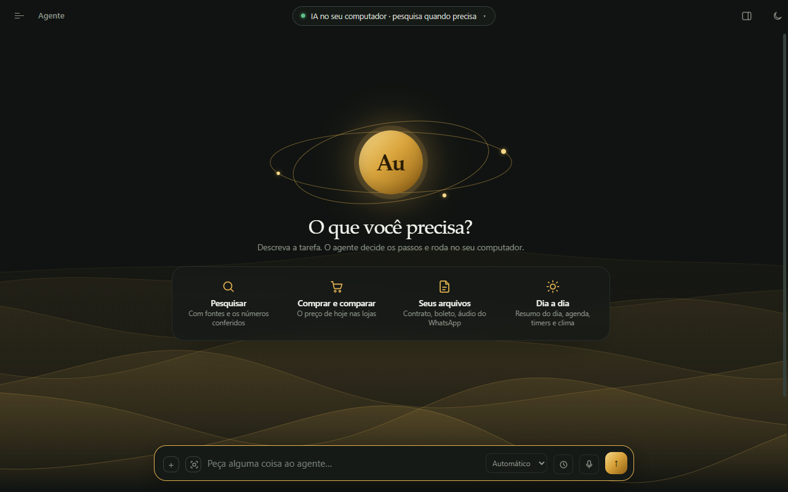
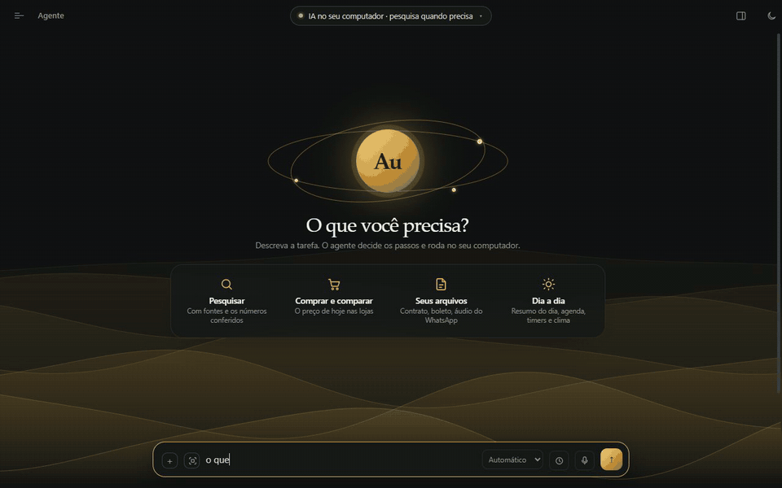
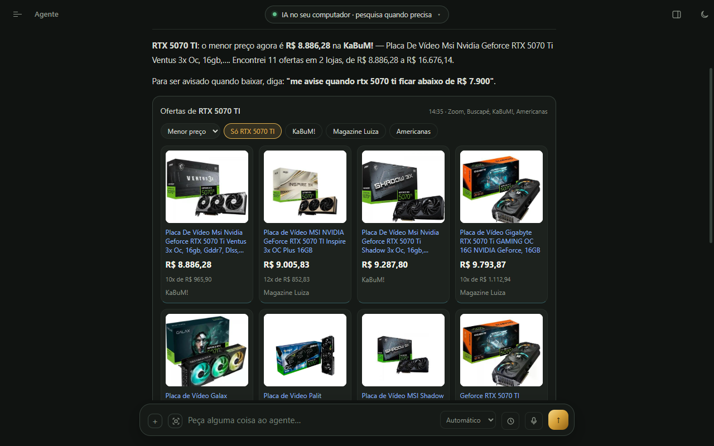
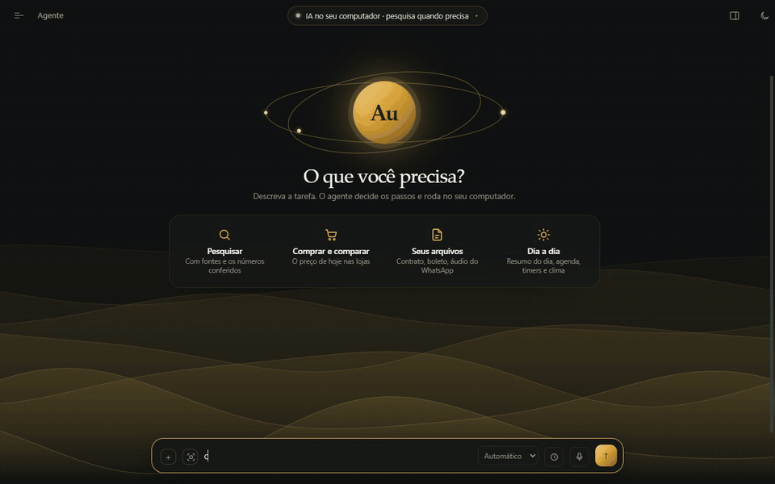
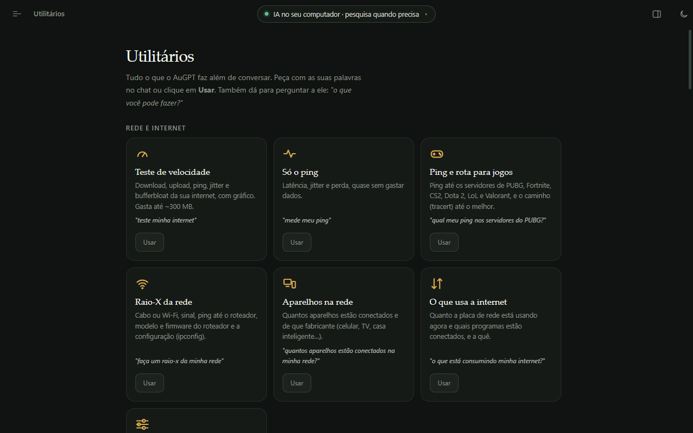

<div align="center">


# AuGPT

**Um assistente de IA que roda no seu computador, em português.**<br>
Pesquisa na web citando as fontes, compara preços nas lojas, lê seus arquivos, cuida do dia a dia e mostra cada passo que deu.<br>
O modelo roda na sua máquina, pelo [Ollama](https://ollama.com): nenhuma conversa vai para um serviço de IA na nuvem.

[](https://github.com/D4v1K1ngg/augpt/releases)
[](#-requisitos)
[](https://ollama.com)
[](LICENSE)

[**⬇️ Baixar**](https://github.com/D4v1K1ngg/augpt/releases) · [Recursos](#-o-que-ele-faz) · [Instalação](#-instalação) · [Segurança](#-segurança-e-rede) · [Como funciona](docs/ARQUITETURA.md) · [🇺🇸 English](README.en.md)

<picture>
  <source media="(prefers-color-scheme: light)" srcset="docs/midia/inicio-claro.png">
  
</picture>

</div>

## ✨ Por que o AuGPT

| | |
|---|---|
| 🔒 **Privado** | A IA roda no seu PC. Conversas, memória e arquivos ficam com você. |
| 🔎 **Cita as fontes** | Toda resposta pesquisada traz os sites lidos, com a data de cada um. |
| ✅ **Confere o que escreve** | Números e anos da resposta são comparados com as páginas lidas; o que não está nas fontes ganha um ⚠. |
| 🛒 **Preço de hoje** | O preço vem da página da loja, não da memória do modelo — e ele avisa quando uma fonte está desatualizada. |
| 👀 **Transparente** | O cartão *Atividade do agente* mostra cada busca e cada página lida; a pesquisa é narrada enquanto acontece. |
| 🇧🇷 **Feito para o Brasil** | Português de verdade, lojas brasileiras, boleto, PTAX do Banco Central, feriados nacionais. |

## 🎬 Veja funcionando

<table>
<tr>
<td width="50%" valign="top">

**Pesquisa com fontes**<br>
<sub>Ele busca, lê as páginas, narra o que está achando e responde citando cada fonte. (Vídeo 4× mais rápido; a resposta real levou 45 s.)</sub>



</td>
<td width="50%" valign="top">

**Cotação na hora**<br>
<sub>Moedas vêm direto dos dados (AwesomeAPI e PTAX do Banco Central), sem esperar a pesquisa.</sub>


</td>
</tr>
<tr>
<td width="50%" valign="top">

**Preços nas lojas**<br>
<sub>"Quanto está a RTX 5070 Ti?" — cartões do menor para o maior, com foto, parcelas e link.</sub>



</td>
<td width="50%" valign="top">

**Timers e alarmes**<br>
<sub>Pelo chat ou pela voz; no fim, bipe e aviso do Windows.</sub>



</td>
</tr>
</table>

## 🧰 O que ele faz

Tudo isto também aparece na aba **Utilitários**, com um botão para usar cada recurso — ou é só perguntar: *"o que você pode fazer?"*

### 🔎 Pesquisa

| | Recurso | Peça assim |
|---|---|---|
| 📰 | **Responde citando as fontes** — várias buscas, lê as páginas, confere números e anos e marca com ⚠ o que não achou | *"o que muda no Wi-Fi 7?"* |
| 🛒 | **Produtos e onde comprar** — recomenda em cartões, com o que a comunidade diz (Reddit e fóruns) e o preço de hoje nas lojas | *"melhor fone até R$ 300 para PUBG"* |
| 🏷️ | **Preços nas lojas** — do menor para o maior, com foto e link, e aviso de preço suspeito | *"quanto está a RTX 5070 Ti?"* |
| 📈 | **Análise e previsão de preço** — linha do tempo desde o lançamento e estimativa para a Black Friday | *"vai ficar quanto na Black Friday?"* |
| 💵 | **Cotação de moedas** — dólar, euro, libra, bitcoin e conversão, com a PTAX do Banco Central | *"100 dólares em reais"* |
| 🧪 | **Investigação com relatório** — pesquisa pelo tempo que você escolher e entrega um PDF completo | modo **Investigação** |
| ▶️ | **Vídeos do YouTube** — assiste pela legenda e lê os comentários mais curtidos | *"resume esse vídeo: <link>"* |
| 🖼️ | **Buscar imagens** — galeria com o site de onde cada foto veio | *"fotos de setups brancos"* |

### ☀️ Dia a dia

| | Recurso | Peça assim |
|---|---|---|
| 🌅 | **Resumo do dia** — data, próximo feriado, o tempo da sua cidade e a sua agenda | *"bom dia"* |
| ⏱️ | **Timers e alarmes** — contagem num cartão, bipe e aviso do Windows | *"alarme às 7h"* |
| 📅 | **Agenda e lembretes** — avisa na hora e acompanha assuntos para você (lançamentos, preços) | *"me lembra de pagar a luz dia 10"* |
| 🧾 | **Contas e boletos** — lê o PDF (valor, vencimento, quem cobra, linha digitável conferida) e lembra na véspera | anexe o boleto |
| 🎙️ | **Transcrever áudio** — mensagem de voz do WhatsApp, gravação ou podcast, com resumo (Whisper, no seu PC) | anexe o áudio |
| ⬇️ | **Baixar vídeos e músicas** — vídeo até 1080p ou só o MP3, pelo link ou pelo nome | *"baixa a música Garota de Ipanema"* |
| 🎵 | **Tocar música** — acha no seu PC e toca no reprodutor do Windows; pausa e pula pela voz | *"toca Legião Urbana"* |
| 🌦️ | **Clima e previsão** — agora, próximas horas e 7 dias (Open-Meteo) | *"vai chover amanhã em BH?"* |
| 🗺️ | **Mapa e rotas** — o lugar num globo, distância e tempo de carro, a pé e de bicicleta | *"rota de Campinas a Santos"* |
| 🗓️ | **Calendário e feriados** — feriados nacionais, quantos dias faltam, dia da semana | *"quando é o próximo feriado?"* |
| 🧠 | **Memória sobre você** — guarda o que você pedir e usa em todas as conversas | *"lembre que eu moro em Curitiba"* |

### 🗣️ Voz

| | Recurso |
|---|---|
| 👂 | **"Ei GPT"** — chame pela voz (o nome você escolhe); o microfone só fica ouvindo se você ligar |
| 🎤 | **Ditado** — fale em vez de digitar; o texto é corrigido antes de enviar (Whisper, no seu PC) |
| 🔊 | **Respostas faladas** — voz natural em português (Kokoro), que narra a pesquisa enquanto acontece |
| 📱 | **Pelo celular** — use o AuGPT do celular na rede da sua casa, com código por QR (desligado por padrão) |

### 💻 Este computador

<sub>Só leitura: nada é mudado e nada sai do PC.</sub>

| | Recurso |
|---|---|
| 📂 | **Onde está aquilo?** — acha documentos nas pastas que você escolher (contrato, conta, currículo, passagem) e responde o que tem neles |
| 💽 | **Espaço e discos** — espaço livre e a saúde de cada SSD/HD |
| 🖥️ | **Configuração do PC** — processador, RAM, placa-mãe, BIOS e placa de vídeo |
| 🔄 | **Windows atualizado?** e **driver da placa de vídeo** — e pesquisa o mais novo se estiver antigo |
| 🖱️ | **Periféricos, som, programas instalados e o que abre com o Windows** |
| 🎛️ | **Controlar o PC pela voz** — volume, mudo, abrir programas, desligar com hora marcada |
| 🪟 | **Mini AuGPT** — o chat numa janelinha sempre por cima das outras, no canto da tela, como o "picture in picture" do navegador (botão na barra ou `Ctrl+Shift+M`) |
| 📸 | **"O que tem na minha tela?"** — `Ctrl+Alt+A` captura uma área e anexa ao chat |
| 🔬 | **Ler outros dados do PC** — chipset, registro, serviços… O AuGPT escreve o comando de PowerShell e o código só deixa rodar o que é leitura ([veja Segurança](#-segurança-e-rede)) |

### 🌐 Rede e internet

| | Recurso |
|---|---|
| 🚀 | **Teste de velocidade** — download, upload, ping, jitter e bufferbloat, com gráfico |
| 🎮 | **Ping e rota para jogos** — PUBG, Fortnite, CS2, Dota 2, LoL e Valorant |
| 📡 | **Raio-X da rede** — cabo ou Wi-Fi, sinal, roteador e os aparelhos conectados |
| 📊 | **O que usa a internet** — quais programas estão conectados, e a quê |
| 🔧 | **Ajustes da placa de rede** — DNS, economia de energia, 5 GHz: mostra o plano, só aplica com a sua aprovação e dá para desfazer |

### 🎨 Criar, sites e arquivos

| | Recurso |
|---|---|
| 📊 | **Gráficos interativos** — colunas, linhas, pizza e projeções, com os dados da pesquisa |
| 🧮 | **Páginas interativas** — calculadoras, simulações e quizzes que rodam dentro da resposta |
| 🖌️ | **Criar imagens** — com o FLUX.2 Klein, no seu PC (instalado por um clique, se a placa comportar) |
| 📷 | **Ler fotos e prints** que você anexar |
| 🌍 | **Navegar em sites** que exigem login, clique ou formulário, num navegador separado |
| 📄 | **Ler e criar arquivos** — PDF, Word, Excel, PowerPoint, OpenDocument, ePub; gera `.docx`, `.xlsx`, `.pdf` e `.html` sem instalar nada |
| 🧩 | **Skills e MCP** — métodos para tipos comuns de tarefa e servidores [MCP](https://modelcontextprotocol.io) para novas ferramentas |

<p align="center">
  
</p>

## 📋 Requisitos

- **Windows 10 ou 11.** O app também abre no Linux e no macOS, mas os recursos do computador e da rede são só do Windows, e esses sistemas são pouco testados.
- **[Ollama](https://ollama.com/download)** — se faltar, a tela de boas-vindas instala e liga para você.
- **Memória:** o que mais pesa é o modelo. Na primeira vez, o app olha a sua placa de vídeo e sugere um destes:

| Placa de vídeo (ou memória) | Modelo sugerido | Como vai ser |
|---|---|---|
| sem placa dedicada, ou menos de 4,5 GB | `qwen3.5:2b` | Funciona, mas erra mais e cada pesquisa leva minutos |
| 4,5 a 7 GB (ou AMD antiga, como a RX 580) | `qwen3.5:4b` | Bom para o dia a dia |
| 8 a 16 GB | `qwen3.5:9b` | ⭐ O recomendado: erra bem menos que o 4B |
| 20 GB ou mais | `qwen3.5:27b` | Respostas melhores, mais lento |

Os modelos Qwen 3.5 também enxergam imagens (fotos e prints anexados).

## 📦 Instalação

**Com o instalador (Windows).** Baixe o `AuGPT Setup x.y.z.exe` em [Releases](https://github.com/D4v1K1ngg/augpt/releases) e rode. O instalador ainda não tem assinatura digital, então o Windows mostra "Editor desconhecido": clique em **Mais informações → Executar assim mesmo**. O app avisa quando sai uma versão nova.

**Pelo código-fonte** (qualquer sistema, com [Node.js](https://nodejs.org) 20 ou mais novo):

```bash
git clone https://github.com/D4v1K1ngg/augpt.git
cd augpt
npm install
npm start
```

Na primeira vez, a tela de boas-vindas confere o Ollama, liga ele se estiver fechado e baixa o modelo recomendado (mais o `nomic-embed-text`, que melhora a memória). É só seguir os botões. Pelo terminal, o equivalente é:

```bash
ollama pull qwen3.5:9b         # ou o da tabela acima
ollama pull nomic-embed-text   # opcional: melhora a memória
```

Componentes extras — yt-dlp e ffmpeg (downloads), Whisper (voz e áudio), FLUX.2 (imagens), SearXNG (busca) — **só são baixados quando você clica** para instalar.

## 🚀 Primeiros passos

Escolha um dos quatro atalhos da tela inicial ou peça algo concreto:

- *"Quais os melhores fones intra-auriculares para PUBG até R$ 300?"*
- *"Teste minha internet"* ou *"qual meu ping nos servidores do PUBG?"*
- *"Meu driver do chipset está atualizado?"*
- *"Leia o contrato.pdf e me diga as multas por cancelamento."*

O seletor ao lado da caixa de mensagem escolhe quanto ele pesquisa: **Automático** (o padrão), **Rápido**, **Normal**, **Profundo** ou **Investigação** (você dá o tempo e recebe um relatório em PDF). O cartão **Atividade do agente** mostra as etapas e os sites consultados; o botão **raciocínio** dentro dele abre cada busca e cada página lida.

Em tarefas com arquivo, pasta, site ou comando, a **autonomia** diz o que ele pode fazer sem perguntar: `manual` confirma toda ação; `guiado` (o padrão) confirma só as arriscadas, como apagar arquivo, rodar comando ou enviar formulário; `automático` não pergunta nada.

Os arquivos que o agente lê e cria ficam em **Documentos/AuGPT Workspace**. A aba **Conversa** é um chat direto com o modelo, sem ferramentas. **Execuções** guarda o histórico de cada pedido, com tempo e o raciocínio passo a passo. Tema **claro e escuro**, com as ondas douradas da tela inicial animadas ou paradas (Ajustes).

## 🛡️ Segurança e rede

O AuGPT é um agente: ele age no seu computador. Vale saber exatamente o que isso significa.

**O que ele pode fazer.** Ler e escrever arquivos na pasta de trabalho, rodar comandos no terminal e código em Python ou JavaScript (com as suas permissões, não só dentro da pasta), abrir sites e preencher formulários no navegador do app. No modo `guiado`, comandos, código, exclusão de arquivos, gravação na memória central e ações em sites pedem sua confirmação antes, e o cartão mostra exatamente o que vai rodar. No modo `automático`, nada pede (o app avisa e pede confirmação antes de ligar esse modo).

<details>
<summary><b>🔐 Proteções que já vêm ligadas</b></summary>

- **Páginas da web são tratadas como dado, não como ordem.** Se uma página tentar fazer o agente abrir um endereço inventado carregando dados (por exemplo, o conteúdo de um arquivo seu), ele para e pede sua confirmação mostrando o endereço.
- **Rede local bloqueada.** O agente não abre endereços do seu computador nem da sua rede (localhost, 192.168.x.x, o roteador), nem por redirecionamento. Dá pra liberar em **Ajustes → Pesquisa na web**.
- **Sem "sempre permitir" pra comando, código e exclusão de arquivo.** Essas ações são aprovadas uma de cada vez.
- **A pasta de trabalho não vaza por atalho.** Links e junções que apontam pra fora dela são recusados.
- **Programas só rodam com a sua confirmação.** Todo servidor MCP novo mostra o comando num aviso do sistema antes de iniciar, e "Abrir com o app padrão" não executa `.exe`, `.bat`, scripts e afins.
- **Comandos não enxergam suas credenciais.** Variáveis de ambiente com cara de segredo (`*_TOKEN`, `*_API_KEY`, `*_SECRET`, `*_PASSWORD`) não são repassadas ao terminal nem ao código que o agente roda.
- **O navegador do app não ganha permissões.** Câmera, microfone, notificações e localização são sempre negados.
- **O PC é só lido.** As consultas ao computador são comandos fixos de leitura. Na leitura livre, em que o modelo escreve o comando, o próprio PowerShell analisa o script antes de rodar e só passa leitura: comandos `Get-*` e de filtrar, programas do Windows em modo de consulta (`reg query`, `gpresult /r`…) e métodos de texto e número. Nada de apagar, parar, instalar, gravar em arquivo ou rodar texto como código, e o script roda em ConstrainedLanguage, sem administrador. Conteúdo de arquivos, senhas e área de transferência ficam de fora.
- **A rede só muda com a sua aprovação.** Os ajustes da placa de rede mostram o plano (antes e depois), só aplicam quando você responde "aplicar", pedem a permissão de administrador do Windows e guardam o estado de antes para "desfazer ajustes de rede".

</details>

<details>
<summary><b>⚠️ O que ainda depende de você</b></summary>

- **Não use o modo automático com uma pasta de trabalho que tenha arquivos importantes.** Nenhuma proteção contra injeção de prompt é perfeita, e no automático nada pede confirmação.
- **Ferramentas extras e servidores MCP rodam com as suas permissões.** Só adicione o que você confia. As ferramentas que você coloca na pasta de ferramentas do usuário (**Skills → Ferramentas → Abrir pasta**) sempre pedem confirmação no modo guiado.

</details>

<details>
<summary><b>🌐 O que sai do seu computador</b></summary>

O modelo de IA roda localmente, mas pesquisar na web exige internet:

- As buscas vão para DuckDuckGo, Marginalia e Wikipédia (ou para o SearXNG embutido, se você ativar).
- Preços: as buscas das lojas (KaBuM!, Zoom, Buscapé) recebem o nome do produto. Cotação: a AwesomeAPI e o Banco Central recebem só o código da moeda.
- O teste de velocidade baixa e envia dados de teste para a Cloudflare (até ~300 MB no completo); o ping dos jogos mede os servidores deles. Nada do seu computador vai junto.
- As consultas ao seu PC, a busca nos seus arquivos, a voz e a transcrição de áudio não usam a internet.
- O leitor externo `r.jina.ai`, que recebe o endereço de páginas que não abrem direto, vem **desligado**. Dá pra ligar em **Ajustes → Pesquisa na web**.
- Ativar o **SearXNG embutido** baixa Python e o SearXNG da internet.

Conversas, memória e registros de execução ficam em arquivos JSON na pasta de dados do app, sem criptografia.

</details>

## 🩺 Problemas comuns

<details>
<summary><b>"ollama offline" no topo</b></summary>

O Ollama não está rodando. Enquanto não houver modelo pronto, a tela do **Agente** mostra o guia de preparação com um botão pra ligar o Ollama; depois disso, o AuGPT oferece ligar sozinho sempre que ele cair. Também dá pra abrir o aplicativo do Ollama ou rodar `ollama serve` num terminal.

</details>

<details>
<summary><b>"Nenhum modelo do Ollama disponível"</b></summary>

Volte à tela do **Agente**: o guia mostra em que passo parou (instalar, ligar ou baixar o modelo).

</details>

<details>
<summary><b>Muito lento</b></summary>

Escolha **Rápido** no seletor da caixa de mensagem, use um modelo menor e reduza **Ajustes → Avançado → Janela de contexto — decisão** para 8192.

O AuGPT também calibra a placa de vídeo sozinho: se o Ollama deixar parte do modelo na RAM do sistema (o que derrubava o `qwen3.5:9b` de 80 para 55 tokens/s numa placa de 8 GB), ele testa uma vez o modelo inteiro na placa e fica com o que for mais rápido.

**Tem um PC com placa de vídeo melhor em casa?** Use o Ollama dele: **Ajustes → Avançado → Conexão → Procurar na rede**.

</details>

<details>
<summary><b>A pesquisa não acha nada</b></summary>

Os buscadores públicos às vezes limitam o acesso. Ative o **SearXNG embutido** em Ajustes, ou aponte pra um SearXNG que você já tenha.

</details>

<details>
<summary><b>Mexi em algum ajuste e piorou</b></summary>

O botão **Restaurar padrões**, no topo de Ajustes, volta todos os ajustes aos valores de fábrica. A pasta de trabalho, o modelo escolhido, as rotinas, os servidores MCP e os domínios marcados continuam como estavam.

</details>

<details>
<summary><b>Uma mensagem de erro que não ajuda</b></summary>

Os erros mais comuns já aparecem explicados, com o texto técnico original numa linha menor embaixo. Pra ver também os cartões internos de recuperação, ligue **Ajustes → Avançado → Mostrar detalhes técnicos da execução**.

</details>

## 🛠️ Para quem quer mexer no código

```bash
npm run avaliar     # ~1.100 casos de teste em ~30 s, sem Ollama nem internet
npm run fumaca      # abre uma cópia isolada do app e confere a tela (precisa do Ollama)
npm run qualidade   # roda o agente de verdade em 56 perguntas e um modelo-juiz dá a nota (precisa do Ollama)
npm run dist        # gera o instalador em dist/
npm run dev         # abre o app com as ferramentas de desenvolvedor
npm run comparar -- qwen3.5:4b qwen3.5:9b   # compara modelos em tarefas reais
```

| Pasta | O que tem |
|---|---|
| `src/agent/` | o laço do agente, o núcleo de pesquisa (`nucleo/`), as rotas que o código responde sozinho (`rotas-do-codigo.js`: cotação, timer, boleto, compras…) e o catálogo de recursos (`capacidades.js`) |
| `src/rede/`, `src/pc/` | teste de velocidade, rotas, raio-X e ajustes da rede; consultas e leitura livre do PC |
| `src/tools/` | as ferramentas (web, arquivos, documentos, navegador, terminal, ofertas das lojas) |
| `src/formatos/` | leitura e geração de PDF, Office e ePub, sem bibliotecas externas |
| `skills/` | os métodos por tipo de tarefa, em Markdown |
| `ferramentas/` | ferramentas extras em JavaScript; copie `_MODELO.js` pra criar uma |
| `electron/`, `renderer/` | o app de desktop e a interface |
| `avaliacao/` | a bancada de testes e a régua de qualidade |
| `dados/` | listas de credibilidade de domínios ([fontes e licenças](dados/FONTES.md)) |

Como o agente funciona e por que cada peça existe: [docs/ARQUITETURA.md](docs/ARQUITETURA.md). Toda correção de bug vira um caso na bancada — rode `npm run avaliar` antes de mandar uma melhoria.

## 📄 Licença

[MIT](LICENSE). As listas em `dados/` vêm de fontes de terceiros com licenças próprias; veja [dados/FONTES.md](dados/FONTES.md).
